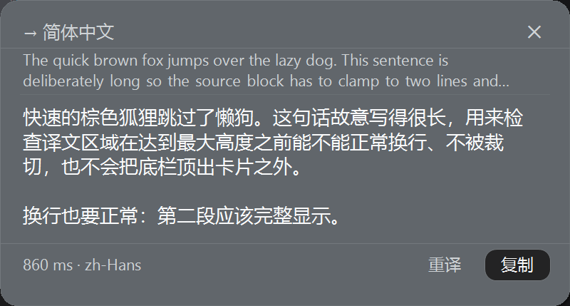
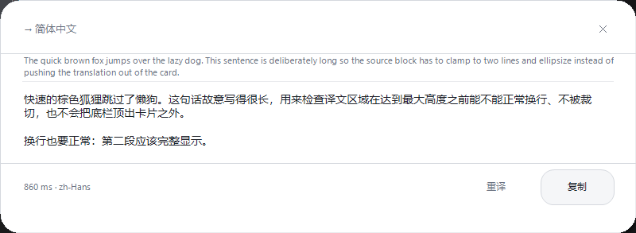

# dsh-translate —— 本地 Ollama 翻译插件

给 DeepSeek Harness Web UI 用的翻译插件：**输入文本翻译、划词翻译（可独立开关）、整份文件翻译**，
翻译内核是你本机 Ollama 里部署的翻译小模型（默认 `kaelri/hy-mt2:1.8b`，Hunyuan-MT2）。

## 功能

| 入口 | 说明 |
|---|---|
| **整页工作台** | 左侧栏面板图标「翻译」→ 整页视图，三个页签：文本 / 文件 / 设置 |
| **划译（DSH 页面内）** | 选中一段文字后**停顿 500ms**（可调）自动弹出译文浮层；Esc / 点空白 / 滚动即取消 |
| **划译（任意应用）** | 系统级：在 Word / 浏览器 / PDF 阅读器里选中文字即译，浮窗贴着光标弹出（见下节） |
| **小图标** | 右下角悬浮按钮：左键打开工作台，**右键菜单**里有「开启/关闭划译」「加载/关闭模型」「刷新状态」「设置」 |
| **文件翻译** | 拖入或选择文件 → 自动按段落切分 → 逐段翻译 → 双语对照导出 `.md` |

## 外部划译（系统级，任意应用）

页面里的 JS 读不到别的程序的选区，所以外部划译由同包的**伴生进程**承担（Windows 自带 PowerShell 5.1，
零外部依赖）：

```
任意应用里选中文字
  ↓ 全局鼠标轮询：拖选（位移 ≥5px）/ 双击选词
  ↓ UI Automation  TextPattern.GetSelection()      ← 主路径，不碰剪贴板
  ↓ 读不到才注入一次 Ctrl+C 读剪贴板（带扫描码；读完还原；终端窗口跳过）
  ↓ POST /dsh-translate/api                        ← 同一条无状态翻译链路
  ↓ 光标旁原生置顶浮窗：译文 / 复制 / 关闭（Esc、点外、20s 自动收起）
```

- **视觉跟页面内浮层一致**：原生窗口是自绘卡片——400 DIP 宽、12px 圆角、跟随 DSH 主题 token
  （卡片底色 / 边框 / 主次文字 / 字体都从页面 `getComputedStyle` 里取，亮暗主题自动跟），
  结构也一样：标题栏（→ 目标语言 + ✕）/ 原文（灰、两行、虚线）/ 译文（13px，超高可滚轮）/
  底栏（耗时 + 重译 + 复制）。高度按实际换行测量，不再有裁切或半截字。

  | 暗色 | 亮色 |
  | --- | --- |
  |  |  |

- **贴着选区弹**：拿到 UIA 的选区矩形后，浮窗放在选区**正下方**、左边缘对齐，下方放不下
  自动翻到选区正上方，两边都放不下就夹在可视区内。
- **不需要热键**：划译总开关 + 「外部（任意应用）」都开（默认都是开）就生效。
- **不重复弹窗**：伴生进程认出 DSH 桌面端窗口（进程 `DeepSeek Harness`）就跳过——那个窗口
  交给页面内浮层；`设置 → DSH 页面内也显示浮层`（默认开）控制页面内浮层本身。
  如果你在普通浏览器里开 DSH 网页，系统侧无法区分标签页，两者会同时出现，关掉页面内浮层即可。
- **OCR 兜底（Windows 自带，无需安装）**：UIA 和剪贴板都拿不到像样文字时，截取选区那块屏幕，
  用系统自带的 `Windows.Media.Ocr` 识别。触发条件是：取不到任何文字（图片型 PDF / 扫描件），
  或取到的文字没有词间空格（`TheInnerProduct`）。英文走 en-US 引擎、中文走系统语言引擎，
  两边都跑再挑更靠谱的结果；中文 OCR 会把每个汉字用空格隔开，这里会先收拢再交给模型。
  实测带选中高亮（浅蓝底黑字）也能认。想关掉：伴生进程加 `-NoOcr`。
- **PDF 文本层丢空格**：不少 PDF 阅读器的 UIA 选区是 `TheInnerProduct` 这种（连末尾换行一起给），
  直接喂模型只会原样吐回。现在先 Trim，若仍无词间空白就先走一次剪贴板取词（有空格优先用），
  再退化成按大小写边界补空格（`TheInnerProduct → The Inner Product`）。
- **剪贴板纪律**：UIA 读得到就一个字节都不碰剪贴板；只有读不到才注入一次 Ctrl+C，
  注入前保存、读到文字后还原；你此刻正按着 Ctrl 就不注入；控制台/终端类窗口直接跳过
  （Ctrl+C 在那里是中断）。
- **清理**：浮窗只承载当前结果；伴生进程随 DSH 走 —— 父进程消失就自己退出，DSH 停用/卸载
  插件时也会杀掉它；模型卸载仍由 Host 的空闲卸载器负责。
- **进程**：`powershell.exe -STA`（5.1，系统自带），端口取当前页面端口，
  日志 `%TEMP%\dsh-translate-capture.log`。

排障：

```bash
# 1) 伴生进程自检：装配 UIA/WinForms、GET 状态、真机翻一句，然后退出（不弹窗）
powershell.exe -NoProfile -STA -ExecutionPolicy Bypass   -File helper/dsh-translate-capture.ps1 -Port 61213 -Target zh-Hans -SelfTest

# 2) 探针：先在目标应用里选中一段文字（别松手后点别处），再跑它——
#    输出 uia / clipboard 两条路各自读到了什么、这次会走哪条
powershell.exe -NoProfile -STA -ExecutionPolicy Bypass   -File helper/dsh-translate-capture.ps1 -Port 61213 -Probe

# 3) 浮窗冒烟：画一帧并截图（验证原生置顶窗口的排版/配色；-ThemePath 可指定主题文件）
powershell.exe -NoProfile -STA -ExecutionPolicy Bypass   -File helper/dsh-translate-capture.ps1 -TestOverlay -ShotPath C:\Temp\overlay.png

# 4) OCR 自检：画三张位图（英文 / 中文 / 选中高亮）走一遍识别，不碰屏幕
powershell.exe -NoProfile -STA -ExecutionPolicy Bypass   -File helper/dsh-translate-capture.ps1 -TestOcr

# 5) 日志（每次手势、取词来源、启动/退出都会写）
type %TEMP%\dsh-translate-capture.log
```

已知边界：Chromium / WebView2 的**无障碍树是「被 UIA 问到才打开」**，首次划词可能读到空
（脚本会自动 160ms 重试一次，并退回焦点元素兜底）；Qt 版 WPS、部分 Office 完全不暴露文档
文本，这类只能走剪贴板兜底；浏览器标签页里的 DSH 页面无法从系统侧区分，双弹窗用上面的
让位开关解决。

参考实现：[germyGao/dsh-select-assist](https://github.com/germyGao/dsh-select-assist)、
[chatclaw 的 Windows 选区检测研究](https://github.com/zhimaai/chatclaw/blob/24cf23210f48daacd4d301bb771fc42745a42ee7/docs/windows-text-selection-detection-research.md)、
[pot-app/pot-desktop](https://github.com/pot-app/pot-desktop)。

## 翻译内核与「清理」

- **无状态**：每次翻译都是 `system + user` 两条消息，一次 HTTP 请求；不复用 `/api/generate` 的
  `context`，不缓存译文，不经过 DSH 的 LLM 通道（因此**不会写进会话日志、不会污染上下文**）。
- **请求级清理**：`AbortSignal` 从浏览器一路贯穿到 Ollama 调用；取消/关闭浮层/切页都会 abort，
  在飞请求不会留在后台。
- **模型级清理**：
  - `keepAlive`（默认 `5m`）控制生成后驻留时长，`0` = 生成结束立刻卸载；
  - 空闲卸载器：无翻译活动超过 `idleUnloadMs`（默认 90s）且模型没有被手动钉住时，主动
    `POST /api/generate {keep_alive:0}` 把模型从显存/共享内存里释放；
  - 手动加载（右键菜单「加载模型」）会**钉住**模型，空闲卸载器不碰它，直到你点「关闭模型」
    或插件被卸载；
  - 插件卸载时（禁用/删包/DSH 退出）abort 在飞请求并 best-effort 卸载。
- 这台机器是 Intel Arc 核显 + 共享内存，模型驻留代价很高（见工作区里的
  `ollama-arc130t-diagnosis.md`），所以默认策略是「用完就放掉」，代价是每次冷启动多 2~3 秒。

## 安装

```bash
# 在任意工作区里，用 DSH 的插件管理器安装本目录（绝对路径）
plugin_manager  action=install_bundle  target=<本目录绝对路径>
```

安装后无需重启：Host 行和 Client 模块图通过 HMR 生效。若页面没变化，刷新一次
`http://127.0.0.1:<port>/` 即可。

## 配置（`cordis.patch.yml` 的 `config`）

| 键 | 默认值 | 含义 |
|---|---|---|
| `baseURL` | `http://127.0.0.1:11434` | Ollama 端点（只应在回环地址上） |
| `model` | `kaelri/hy-mt2:1.8b` | 翻译模型 |
| `keepAlive` | `5m` | 生成后驻留时长；`0` = 立即卸载 |
| `idleUnloadMs` | `90000` | 空闲多久主动卸载；`0` = 关闭 |
| `timeoutMs` | `120000` | 单次 Ollama 请求超时 |
| `maxTextChars` | `20000` | 单次翻译文本上限 |
| `chunkChars` | `1200` | 分段长度（超长文本按段落/句子切分） |
| `maxUploadBytes` | `12582912` | 上传文件大小上限（12 MB） |
| `defaultTarget` | `auto` | 默认目标语言；`auto` = 中↔英 |
| `tone` | `natural` | 默认语气 |

界面里的「设置」页只覆盖**本次浏览器**的偏好（存 `localStorage`），不会写回 `cordis.patch.yml`；
模型与 `keepAlive` 随请求下发，改完立即生效。

## 支持的文件格式

- **文档**：`.docx` / `.docm` / `.xlsx` / `.xlsm` / `.pptx` / `.pptm` / `.epub`
- **文本**：`.txt` `.md` `.mdx` `.rst` `.adoc` `.tex` `.csv` `.tsv` `.json` `.jsonl`
  `.yaml` `.yml` `.ini` `.toml` `.env` `.html` `.htm` `.xhtml` `.xml`
- **字幕**：`.srt` / `.vtt` —— 按行处理，序号与时间轴原样保留，只翻文本行；导出仍是合法字幕
- **不支持**：`.pdf`、旧版二进制 `.doc` / `.xls` / `.ppt`、`.ass` / `.lrc`（时间轴与文本同行，逐行翻译会破坏时间戳）；会明确报错而不是静默失败

解析只在本机 Host 进程里做（ZIP + XML 抽取，无第三方依赖）；代码围栏（```）会被识别为
`code` 段**原样保留不翻译**。

## 自检

```bash
# Host 半边：纯函数 + docx/xlsx/pptx/epub 解析 + 路由（含真机 Ollama）
node tests/selftest.mjs          # 离线部分
node tests/selftest.mjs --live   # 额外跑一次真实翻译并卸载模型

# Client 半边：加载器契约 + 槽位注册 + 组件渲染冒烟
node tests/client_selftest.mjs
```

## 已知限制

- 一次只翻一段（串行），保证小模型显存与延迟稳定；取消会立刻停止后续段。
- `繁體中文` 用中文语言名 + 中文提示驱动（1.8B 模型对英文语言名会输出简体），实测短句/段落/简→繁都稳定。
- OCR 有识别噪声（`Inner` 偶尔认成 `lnner`、`If` 认成 `阡`），但整段语义足够模型翻译；
- 页内划译只作用于页面内可选中的文本；输入框/可编辑区域/DOM 之外的选区会被忽略（外部划译另外处理）。
- 路由只在回环地址上服务，没有额外的令牌鉴权（与宿主自身「只绑回环」的部署假设一致）；
  请求侧校验 `Origin` / `Sec-Fetch-Site`，跨站请求一律 403。
- 宿主配置（`idleUnloadMs` 等）只能改 `cordis.patch.yml`，设置页里是只读展示。

## 卸载

```bash
plugin_manager  action=remove_bundle  target=dsh-translate
```

卸载时会把插件加载过的模型卸载掉，并清掉本页注册的槽位与监听。
