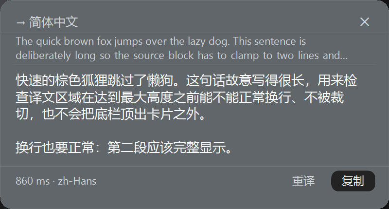
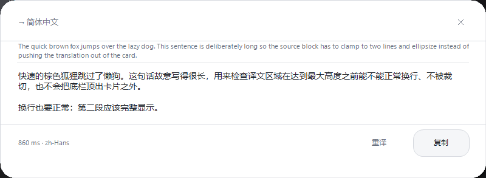
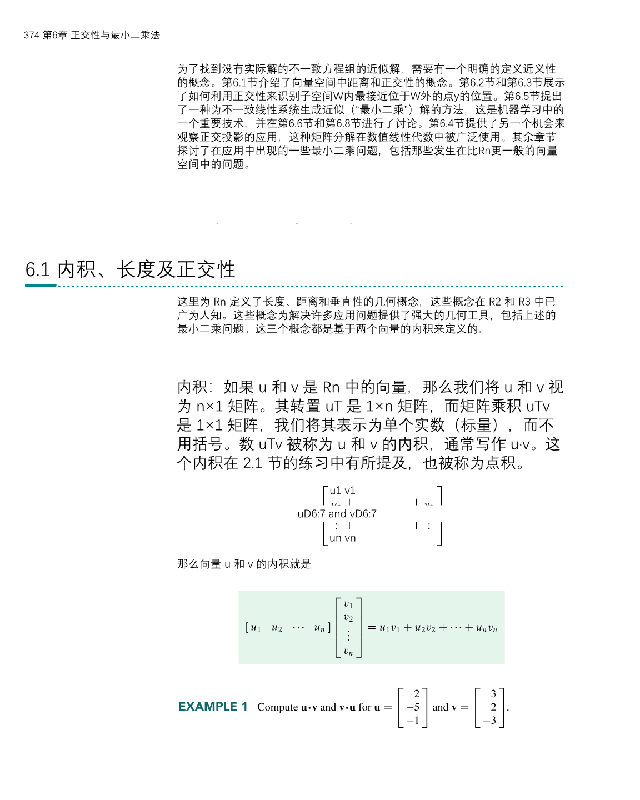
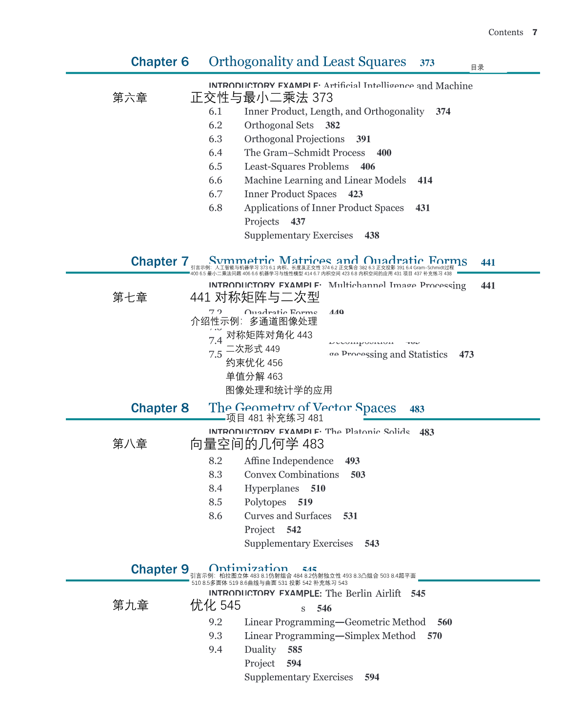

# dsh-translate

给 [DeepSeek Harness](https://github.com/deepseek-ai/deepseek-harness) 用的**本地翻译插件**：
文本、页面内划译、系统级划译（任意应用）、整份文件翻译——内核是你自己 Ollama 里的小模型，
请求不出本机，每次翻译互不携带上下文，空闲后自动卸载模型。





---

## 能力一览

| 入口 | 说明 |
|---|---|
| **文本翻译** | 整页工作台里粘贴/输入，可选中英↔多语、语气、术语表 |
| **页内划译** | 在 DSH 页面里选中文字，停顿 500ms（可调）自动弹译文；Esc / 点空白 / 滚动即取消 |
| **系统级划译** | 在 Word / 浏览器 / PDF 阅读器等**任意应用**里选中文字即译，浮窗贴选区弹出（Windows） |
| **文件翻译** | 拖入 docx / xlsx / pptx / epub / txt / md / srt 等，按段推进度、双语对照导出 |
| **PDF 翻译** | 原版式写回：默认「覆盖」（译文替换原文）或「对照」（每页原文后插译文页）；扫描页可 OCR |
| **模型管理** | 工作台里看服务状态、切换模型、加载/钉住/卸载模型；自动跟随 DSH 主题 |

取词（系统级）维持三层回退：**UI Automation → 剪贴板 → OCR**。
剪贴板这一层做了「不打扰复制」的处理（见下节），PDF 文本层丢空格/首字母时最终由 OCR 重读补全；
扫描件也因此能翻。

## 平台支持

| 能力 | Windows 10/11 | macOS / Linux |
|---|---|---|
| 页内划译、文本、文件翻译 | ✅ | ✅ |
| PDF 翻译（覆盖 / 对照） | ✅ | ✅（纯 JS：pdf.js + pdf-lib；需能安装 npm 依赖） |
| 系统级划译（任意应用） | ✅（UI Automation + 剪贴板 + OCR + 原生浮窗） | —（插件会明确提示，不影响页内划译） |
| OCR 兜底 | ✅（系统自带 WinRT OCR） | —（跟随系统级划译） |

系统级划译不安装任何额外运行时：脚本用系统自带的 Windows PowerShell 5.1，
OCR 用系统自带的 `Windows.Media.Ocr`，浮窗是自绘的原生窗口。

## 前置条件

1. **Ollama**（≥ 0.3）在本机运行：默认地址 `http://127.0.0.1:11434`。
   没在跑也没关系——**插件会自动拉起**（默认开，最多等 25 秒；优先拉起带托盘图标的 `ollama app.exe`，
   失败再退到 `ollama serve`）；找不到 `ollama.exe` 时可在配置里指定 `ollamaExe`。
2. **一个翻译模型**。推荐：
   ```bash
   ollama pull kaelri/hy-mt2:1.8b     # Hunyuan-MT2 1.8B，约 1.5 GB，加载快
   ```
   不想装这个也行——装好后在插件「设置 → 模型」里换成本机已有的任意模型。
3. （仅系统级划译）Windows 10/11；PowerShell 5.1 与 OCR 语言包都是系统自带。

## 安装

装完**刷新一次页面**即可生效（Host 行与客户端模块会热更新）。

### 方式 A：DSH 桌面端 · 插件管理界面

1. `git clone https://github.com/Azurwolf1024/dsh-translate`
2. 打开 **设置 → 插件 → 添加 / 安装**，选择克隆下来的目录
3. 刷新页面，左栏出现「翻译」图标

### 方式 B：命令行

```bash
# 从 GitHub 直接装（推荐）
dsh plugin --profile web add "github:Azurwolf1024/dsh-translate"

# 或从本地目录
git clone https://github.com/Azurwolf1024/dsh-translate
dsh plugin --profile web add ./dsh-translate

# 装完按提示重启 / 刷新
```

### 方式 C：npm（若已发布）

```bash
dsh plugin --profile web add dsh-translate
```

> 本包**没有构建步骤**：`index.js` / `client.js` 就是最终产物，`helper/` 是伴生进程脚本，
> 所以从 git 源安装不需要 `pnpm build`。

## 首次使用（3 步）

1. 打开左栏 **「翻译」**（或右下角悬浮小图标）→ 整页工作台。
2. 若顶部出现橙色提示「本地还没有翻译模型」：点 **复制命令**，在终端执行 `ollama pull …`，再点 **重新检测**。
   也可以直接去「设置 → 模型」选一个本机已装的模型。
3. 随便翻译一句；第一次会多等 2~3 秒（模型冷加载），之后约 0.5~1 秒。

## 使用

- **页内划译**：在 DSH 对话里选中文字，停一下即弹浮层；右下角小图标右键可开关划译。
- **系统级划译（Windows）**：在任意应用里拖选/双击选词 → 浮窗贴在选区正下方（放不下翻到上方）。
  可在小图标右键菜单或「设置 → 划译」里单独开关。
- **文件翻译**：拖入文件 → 自动按段落切分 → 开始翻译（可暂停/取消）→ 导出 `.md`（双语对照或仅译文）。
- **设置**：模型、生成后驻留时长、目标语言、语气、术语表、划译开关与停顿、诊断信息。

### 支持的文件格式

- **文档**：`.docx` / `.docm` / `.xlsx` / `.xlsm` / `.pptx` / `.pptm` / `.epub`
- **文本**：`.txt` `.md` `.mdx` `.rst` `.adoc` `.tex` `.csv` `.tsv` `.json` `.jsonl`
  `.yaml` `.yml` `.ini` `.toml` `.env` `.html` `.htm` `.xhtml` `.xml`
- **字幕**：`.srt` / `.vtt` —— 按行处理，序号与时间轴原样保留，只翻文本行；导出仍是合法字幕
- **PDF**：原版式写回，见下节；旧版二进制 `.doc` / `.xls` / `.ppt`、`.ass` / `.lrc` 不支持（会明确报错）

## PDF 翻译



- **覆盖（默认）**：按段落块把原文区域盖上底色、在原位写译文，版式与分页保持不变；
  **公式 / 矩阵 / 代码块**按启发式识别后**保留原文**（不译），避免模型把公式翻坏。
- **对照**：每页原文后面插入一页同版式的译文页，适合打印或逐页比对。
- **扫描件**：没有文本层的页会先 OCR（Windows 自带识别引擎），OCR 出带坐标的行后再按同样方式排版。
  
- **实现**：`pdf.js`（解析文字层/坐标）+ `pdf-lib`（写回 PDF），都是纯 JS 依赖，由插件管理器随包安装。
- **中文字体**：默认自动找系统单文件 TTF（Windows：等线 `Deng.ttf`）；其它平台或想换字体时，
  在配置里指定 `pdfFont`（必须是 `.ttf/.otf` 单文件，TTC 集合不支持）。
- **分块与校验**：每块 ≤ 560 字符（句子边界可放宽），按栏切分；译文若没翻成中文会用更严格的提示重试，
  仍失败就保留原文并在界面标出（不再静默“没翻译”）。
- **排版统计**：生成后显示「已翻译 N 块 · 校验未通过 X · 溢出 Y · 重叠 Z」，方便判断哪页要人工看。
- **已知边界**：多栏/目录页的段落切分是启发式的（公式多的教科书偶有错位）；图内文字（位图里的字）不翻；
  旋转文字跳过不翻；模型偶发幻觉（长段落更明显）；OCR 只有 Windows 可用；
  超长文档解析较慢（约 12ms/页）；对照模式会把文件体积翻倍。

### 取词与复制（系统级划译）

三层顺序保持不变：

1. **UI Automation**（主路径，不碰剪贴板）
2. **剪贴板**——分两种走法，优先被动：
   - 你在手势期间自己按过 Ctrl+C（剪贴板序号变了）→ **直接读你复制的内容，绝不注入**；
   - 否则才注入一次 Ctrl+C 取词：注入前保存、读完**只还原自己写的那次**（若期间你自己又复制了，不覆盖你的）；
     按住 Ctrl 时不注入；控制台/终端窗口跳过。
3. **OCR**——剪贴板也没拿到、或拿到的仍是粘成一串的文本时，OCR 重读选区（能补回空格和漏掉的首字母）；
   最后才退到按大小写边界补空格。

日志里 `source=` 会写明走了哪条：`uia` / `clipboard` / `clipboard-passive` / `clipboard+ocr` / `ocr` / `…-respaced`。

- **复制优先**：松手后等 120ms 再取词，这期间按了 Ctrl（想复制）就跳过翻译。
- **取不到选区矩形时**：拖拽用拖拽框、双击/点选用鼠标附近的一行词框去 OCR（以前这里会截 0×0 区域，等于没兜底）。
- **管理员应用**：只有目标权限**高于我们**时（比如我们是普通权限、目标是管理员），Windows 才会拦截
  UI Automation 和模拟按键；此时自动降级到 OCR（截屏不受限），仍取不到会弹一次「划译受限」提示。
  若 DSH 本身以管理员运行，helper 同级别，管理员应用可以正常走 UIA/剪贴板。
- **完全不想被注入**：把配置 `clipboardFallback` 设为 `false` —— 剪贴板层只剩「被动读」，绝不注入。

## 配置

默认值在 `cordis.patch.yml` 的 `config` 里。要覆盖，把你的字段写进 profile 的 patch（按 `id` 覆盖整块 config）：

```yaml
- id: dsh-translate
  config:
    model: 'qwen3.5:4b-chat'      # 换了模型就填这里
    keepAlive: '2h'               # 模型驻留时长（默认 2 小时；'0' = 每次翻完卸载，最省内存但每次冷加载）
    idleUnloadMs: 0               # 0 = 不主动卸载（避免每次重载让 Ollama 启动子进程、闪控制台）
    defaultTarget: 'zh-Hans'      # 不填 auto = 中↔英自动
```

| 键 | 默认值 | 含义 |
|---|---|---|
| `baseURL` | `http://127.0.0.1:11434` | Ollama 端点 |
| `model` | `kaelri/hy-mt2:1.8b` | 翻译模型（设置页可临时切换） |
| `keepAlive` | `2h` | 生成后模型驻留时长；`0` = 立即卸载 |
| `idleUnloadMs` | `0` | 空闲多久主动卸载模型；`0` = 不卸载（避免每次重载让 Ollama 闪控制台） |
| `timeoutMs` | `120000` | 单次 Ollama 请求超时 |
| `maxTextChars` | `20000` | 单次翻译文本上限 |
| `chunkChars` | `1200` | 分段长度 |
| `maxUploadBytes` | `12582912` | 上传文件大小上限（12 MB） |
| `maxPdfBytes` | `62914560` | PDF 原文件上限（60 MB） |
| `pdfFont` | `''` | 生成 PDF 用的中文字体路径（留空自动找系统字体） |
| `clipboardFallback` | `true` | 剪贴板层是否允许「注入一次 Ctrl+C」；`false` = 只被动读，绝不注入 |
| `autoStartOllama` | `true` | 连不上 Ollama 时自动拉起并等待就绪（优先托盘应用，端口被占时不会重复拉起） |
| `ollamaExe` | `''` | 指定 ollama.exe 路径（留空自动找 PATH / 常见安装目录） |
| `ollamaStartTimeoutMs` | `25000` | 等待 Ollama 启动完成的上限 |
| `ollamaLaunch` | `auto` | 自动启动方式：`auto`=优先托盘应用（带图标）、`app`、`serve`（纯后台） |
| `defaultTarget` | `auto` | 默认目标语言 |
| `tone` | `natural` | 默认语气 |

## 无状态与清理

- **每次翻译 = 一次独立请求**：`system + user` 两条消息，不复用 KV/context、不缓存译文、
  **不经过 DSH 的 LLM 通道**，所以不会写进会话日志、不污染上下文。
- **请求级**：`AbortSignal` 从浏览器一路到 Ollama；取消/关闭浮层/切页都会终止生成。
- **模型级**：`keepAlive` + 空闲卸载器（默认 90s）把模型从显存/共享内存释放；手动「加载模型」会钉住它。
- **进程级**：伴生进程随 DSH 走（父进程消失即退出；插件卸载时被杀）。

## 排障

先看日志：`%TEMP%\dsh-translate-capture.log`（系统级划译）与工作台「设置 → 服务状态」。

```bash
# 1) 伴生进程自检：装配 UIA/WinForms、GET 状态、真机翻一句，然后退出（不弹窗）
powershell -NoProfile -STA -ExecutionPolicy Bypass \
  -File helper/dsh-translate-capture.ps1 -Port 61213 -Target zh-Hans -SelfTest

# 2) OCR 自检：画英文/中文/选中高亮三张位图走一遍识别（不碰屏幕）
powershell -NoProfile -STA -ExecutionPolicy Bypass -File helper/dsh-translate-capture.ps1 -TestOcr

# 3) 浮窗冒烟：画一帧并截图
powershell -NoProfile -STA -ExecutionPolicy Bypass \
  -File helper/dsh-translate-capture.ps1 -TestOverlay -ShotPath C:\Temp\overlay.png

# 4) 探针：先在目标应用里选中文字，再跑它——看 UIA / 剪贴板各读到什么
powershell -NoProfile -STA -ExecutionPolicy Bypass -File helper/dsh-translate-capture.ps1 -Probe
```

| 现象 | 处理 |
|---|---|
| 工作台顶部提示「连不上本地 Ollama」 | 启动 Ollama（`ollama serve` / 打开应用），点重新检测 |
| 提示「本地还没有翻译模型」 | 复制命令 `ollama pull …`，或去设置换模型 |
| 系统级划译没反应 | 看日志最后几行：`gesture app=… source=…`；确认划译总开关与「外部」开关都开 |
| PDF 出来是 `TheInnerProduct` 这类连写 | 正常：会自动走剪贴板/OCR/补空格；若仍不行把日志发我 |
| 提示「连不上本地 Ollama」 | 点提示条上的「启动 Ollama」；或确认 `ollama serve` 能正常启动、必要时配置 `ollamaExe` |
| 图片型 PDF / 扫描件 | 走 OCR（日志 `source=ocr`）；OCR 语言包缺失时会在日志写 `ocr engine unavailable` |
| 翻译很慢 | 冷加载 2~3 秒正常；把 `keepAlive` 调成 `5m` 可减少冷启动 |

## 开发

```
index.js                  Host 半边：Ollama 客户端、分段、卸载器、/dsh-translate/api
client.js                 浏览器半边：整页工作台 / 划译浮层 / 小图标（手写 bundle，无需构建）
helper/dsh-translate-capture.ps1   Windows 伴生进程：手势 → UIA/剪贴板/OCR → 原生浮窗
cordis.patch.yml         bundle 行与默认配置
locale/{en,zh}.json      插件元数据标题/描述
tests/                   Host 与 Client 的离线/真机自检
```

```bash
npm test              # 离线：纯函数 + 文件解析 + 路由 + 客户端渲染冒烟
npm run test:live     # 额外跑一次真实 Ollama 翻译（会加载并卸载模型）
npm run selftest:helper / selftest:ocr / selftest:overlay   # Windows 伴生进程三段自检
```

无构建步骤；改了 `index.js` / `helper/*.ps1` 后重装或重启 DSH 生效，改 `client.js` 刷新页面。

## 卸载

```bash
dsh plugin --profile web remove dsh-translate
```

或在「设置 → 插件」里停用/删除。卸载时会中止在飞请求、卸载插件加载过的模型、结束伴生进程。

## License

MIT © Azurwolf1024

---

## English Quickstart

A local-Ollama translation plugin for DeepSeek Harness: text, in-page selection popup,
system-wide selection (Windows: UI Automation → clipboard → OCR), and file translation.
Requests stay on your machine, every translation is stateless, and the model is unloaded when idle.

```bash
# 1. Ollama + a translation model
ollama pull kaelri/hy-mt2:1.8b

# 2. Install the plugin
dsh plugin --profile web add "github:Azurwolf1024/dsh-translate"

# 3. Open the sidebar "Translate" panel and translate something
```

Platform: in-page selection, text and file translation work everywhere; system-wide selection
requires Windows 10/11 (built-in PowerShell, UIA and WinRT OCR — no extra runtime).

Troubleshooting: see `%TEMP%\dsh-translate-capture.log` for the companion process, and run
`npm test` (offline) or the PowerShell self-tests listed above.
